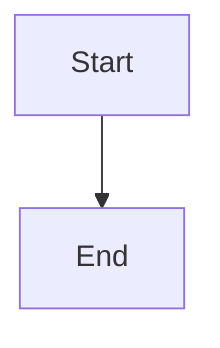

# MD Preview

macOS 上的離線 Markdown、Mermaid 與 JSON 預覽器（SwiftUI + WKWebView）。開啟資料夾後，可在側欄樹狀瀏覽並快速切換檔案；也可貼上 JSON 預覽。這是預覽工具，不提供文件編輯或雲端同步。

支援 `.md`、`.markdown`、`.mdown`、`.mkd`、`.mkdn`、`.mdx`、`.mmd` 和 `.json`，副檔名不分大小寫。

## 需求

- macOS 14 Sonoma 以上
- Xcode 16 以上（專案使用 Xcode 16 的「同步資料夾」格式，`MDPreview/` 內新增的 .swift 檔會自動加入編譯）

## 執行

```bash
open MDPreview.xcodeproj   # 然後在 Xcode 按 ⌘R
# 或不開 Xcode，直接打包，不安裝：
./build.sh --no-install    # 產出 build.noindex/Release/MDPreview.app
```

第一次執行後按 ⌘O 選 `Samples/` 資料夾就能測試所有功能。

## 安裝與「打開檔案的應用程式」

建議只保留一份 app 在「應用程式」資料夾，Spotlight 和 Finder 的「打開檔案的應用程式」才不會出現重複或抓到舊版：

```bash
./build.sh                # build 並替換 /Applications/MDPreview.app
```

build 產物放在 `build.noindex/`，資料夾名稱結尾的 `.noindex` 讓 Spotlight 不收錄，所以不會出現第二份。
Xcode 按 ⌘R 產生的 Debug 版在 `~/Library/Developer/Xcode/DerivedData/`，若它也出現在搜尋結果，
可到「系統設定 → Spotlight → 搜尋隱私」把 DerivedData 資料夾加進去。

之後在支援的檔案按右鍵 →「打開檔案的應用程式」選擇 MD Preview；也可以把檔案或資料夾拖到 Dock 上的圖示。開啟單一檔案時，會打開它所在的資料夾並選取該檔。

## 功能與快捷鍵

| 功能 | 操作 |
| --- | --- |
| 開啟資料夾 | ⌘O、工具列按鈕，或把資料夾 / 支援的檔案拖進視窗 |
| 貼上 JSON | ⇧⌘V 或工具列按鈕，輸入後按 Preview |
| JSON 全部展開 / 收合 | View → Expand All / Collapse All |
| 快速開啟（模糊搜尋） | ⌘P，↑↓ 選擇、Enter 開啟、Esc 關閉 |
| 側欄篩選 | 側欄上方搜尋框 |
| 下一個 / 上一個檔案 | ⌥⌘↓ / ⌥⌘↑（側欄聚焦時也可直接用 ↑↓） |
| 重新載入 | ⌘R（平常不需要，存檔會自動重載） |
| 在 Finder 顯示 / 用預設編輯器開啟 | ⇧⌘R / ⌘E，或側欄右鍵 |
| 縮放 | ⌘= / ⌘- / ⌘0 |
| 外觀（系統 / 淺色 / 深色） | 工具列外觀按鈕、View → Appearance，或 ⇧⌘L 循環切換 |

- **遞迴子資料夾**：只顯示含有支援檔案的資料夾；略過隱藏項目、`node_modules`、`build` 等及符號連結目錄，掃描深度上限為 16
- **自動重載**：FSEvents 監看整個資料夾，外部編輯器存檔即更新，且保留捲動位置；新增 / 刪除檔案時側欄同步更新
- **渲染**：GFM（表格、task list、刪除線）、程式碼高亮、YAML front matter 折疊顯示、相對路徑圖片、文件內 `#anchor` 與 `.md` 之間的連結
- **外觀**：預設跟隨系統，也可固定淺色或深色（app 與預覽一起切換）
- 重開 app 會回到上次的資料夾與檔案

## JSON 預覽

- `.json` 檔案以可展開、收合的樹狀結構顯示；大型樹狀預覽會限制顯示數量，並可切換至原始文字。
- 無效 JSON 會顯示錯誤提示與原始文字。解析或顯示超過限制時，也會提供提示與原始文字。
- JSON 檔案上限為 50 MiB；貼上的 JSON 上限為 5 MiB（UTF-8）。貼上的內容只存在目前視窗的記憶體中，不會儲存為檔案或在重啟後保留。

## Mermaid 圖表

預覽支援離線渲染 Mermaid 圖表：在 md 檔中用圍欄式（fenced）mermaid 區塊即可，例如：

````md

````

- **離線**：使用隨附的 `Web/mermaid.min.js`（Mermaid 11.4.1），不需網路即可渲染，授權條款見 `Web/MERMAID-LICENSE.txt`（MIT）
- **外觀**：圖表會跟隨預覽的淺色 / 深色主題切換
- **錯誤處理**：某個區塊語法錯誤時，該區塊會顯示錯誤訊息，其餘區塊仍照常渲染
- `.mmd` 檔案也可直接開啟並渲染為 Mermaid 圖表
- 測試用範例見 `Samples/Mermaid.md`（含多種圖表類型、一個刻意寫錯的區塊，以及錯誤之後仍能正常渲染的區塊）

## 結構

```
MDPreview.xcodeproj
MDPreview/              Swift 原始碼（同步資料夾）
  MDPreviewApp.swift    App 進入點、選單指令
  Workspace.swift       視窗狀態：資料夾、檔案樹、目前檔案、搜尋、連結處理
  FileScanner.swift     遞迴掃描支援的檔案
  FolderWatcher.swift   FSEvents 監看
  ContentView.swift     NavigationSplitView 主畫面
  SidebarView.swift     側欄樹狀 / 篩選結果
  QuickOpenView.swift   ⌘P 快速開啟
  MarkdownWebView.swift WKWebView + 自訂 mdpreview:// scheme
  Appearance.swift      淺色 / 深色 / 跟隨系統切換
Web/                    共用預覽頁 HTML/JS/CSS 與離線相依資源
Samples/                手動測試範例
Tests/、MDPreviewUITests/、test/  Swift、macOS UI 和 Web 測試
```

## 測試

安裝 Xcode 和 Node.js 後，執行 `./test.sh` 可執行 Swift、Web 和 macOS UI 測試；`./test.sh --cov` 額外列出 Swift 行覆蓋率。手動測試可開啟 `Samples/`，檢查渲染、連結、圖片與自動重載。

## 說明

- 為了能直接讀任意資料夾並記住上次位置，App Sandbox 是關閉的（自用工具的常見做法）。若要上架 Mac App Store，需要改用 security-scoped bookmarks。
- 預覽頁與本機資源透過 `mdpreview://` 自訂 scheme 提供。HTTP、HTTPS 和 mailto 連結由系統開啟；Markdown 仍可能包含遠端資源，離線可用不代表所有網路請求都會被阻擋。
