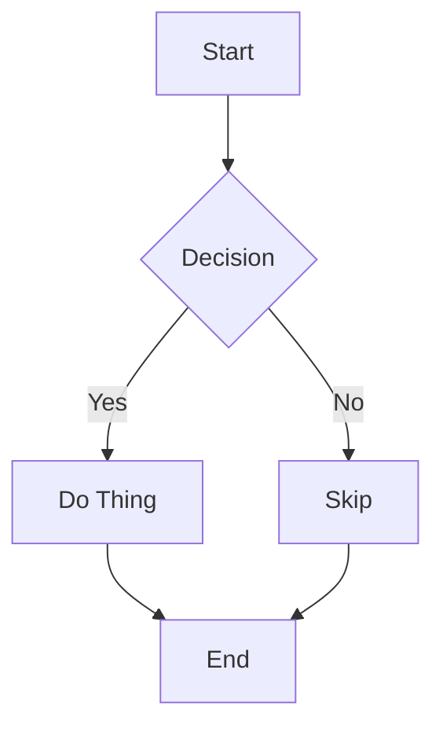
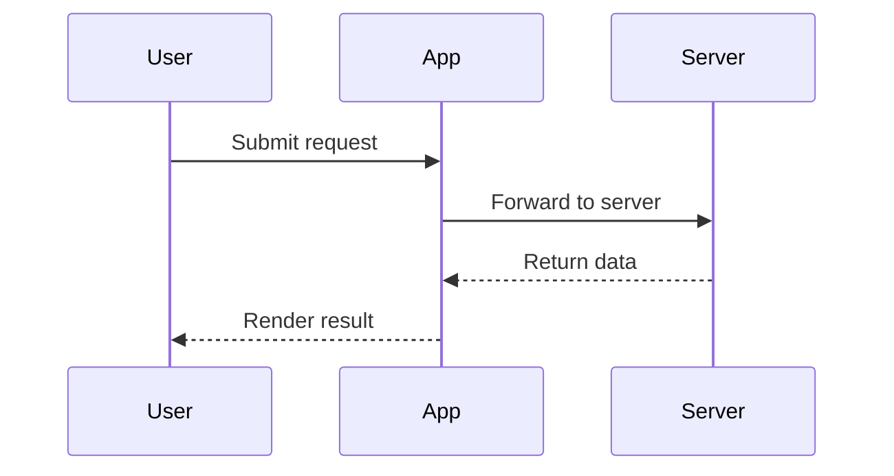
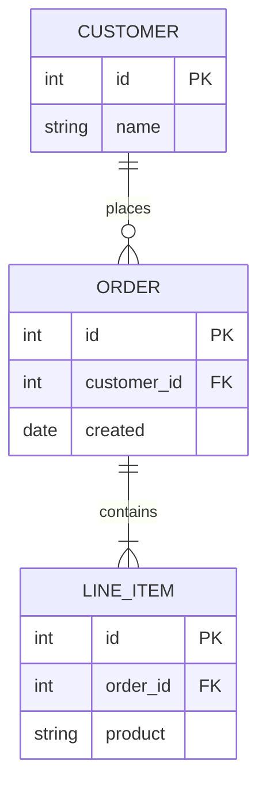
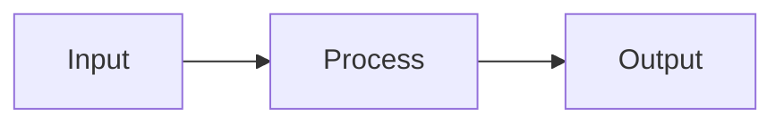

# Mermaid Diagram Samples

This file exercises the Mermaid rendering path with several valid diagram types,
an intentionally broken block, and a valid block that follows the broken one.

## Flowchart



## Sequence Diagram



## Entity-Relationship Diagram



## Intentionally Invalid Block

The following block is **deliberately malformed** to exercise the viewer's
error-handling path. The graph is left half-built and uses an undefined node
reference, so the Mermaid parser should report an error.

```mermaid
graph LR
    A --> B
    B --> C
    D --
```

> Note: The error above is intentional. The `D --` line is an incomplete edge
> and the diagram never terminates, so rendering should fail gracefully.

## Valid Diagram After the Invalid One

This block should render correctly and demonstrates recovery after a parse
error.


